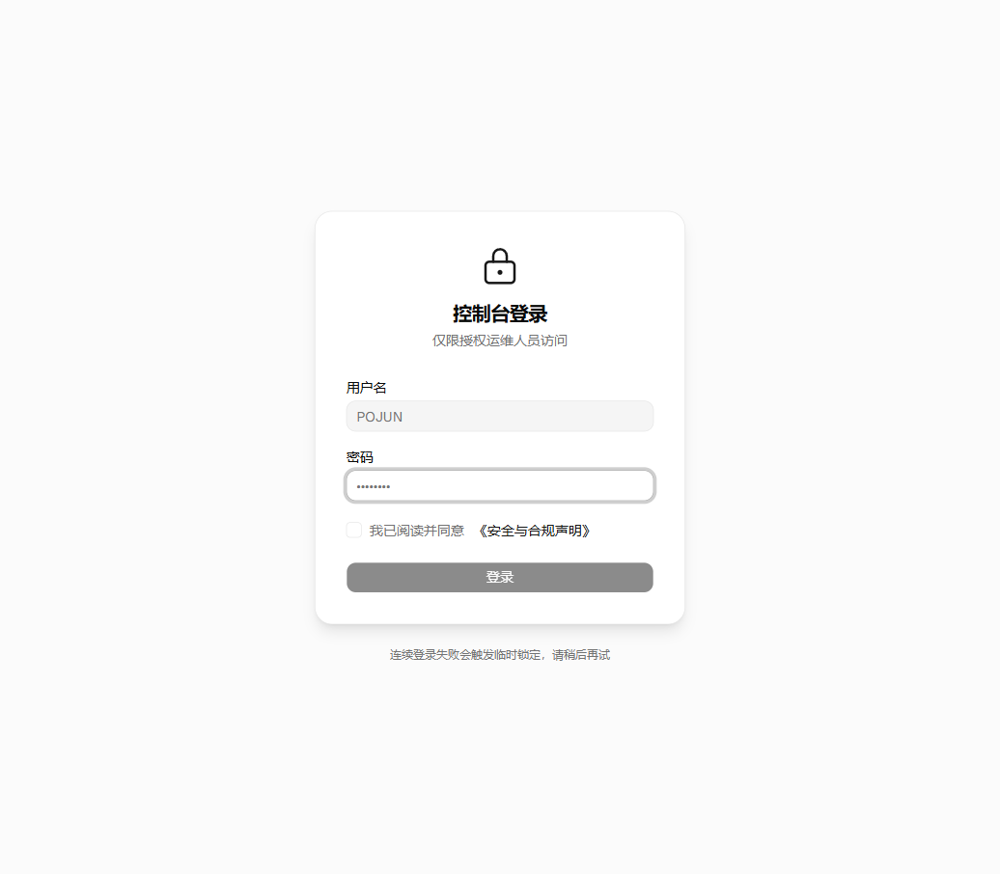
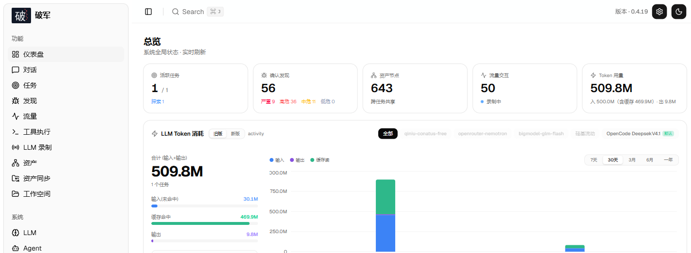
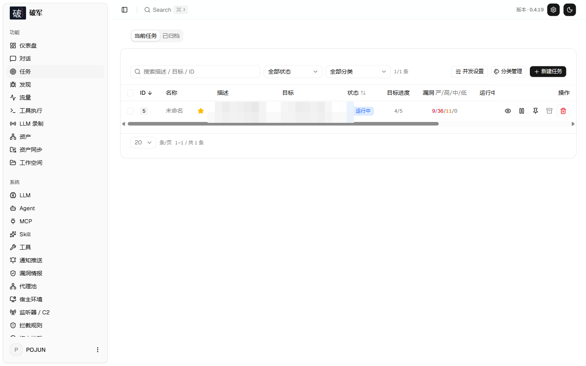
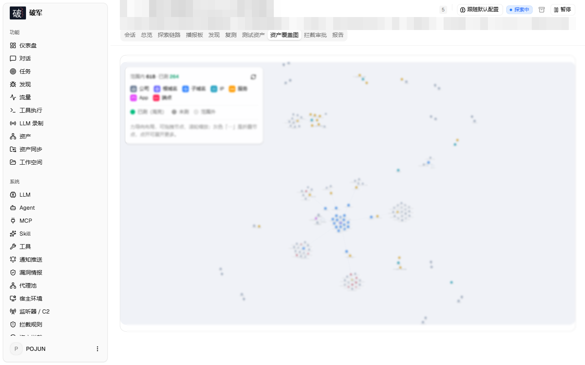
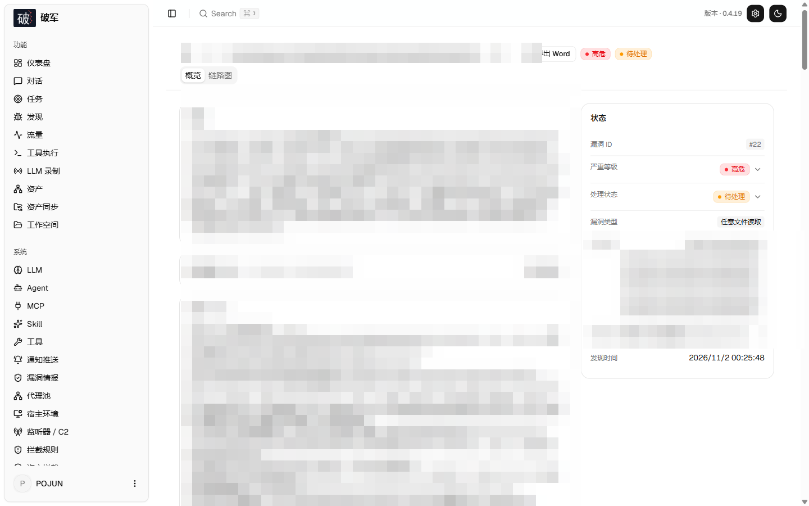
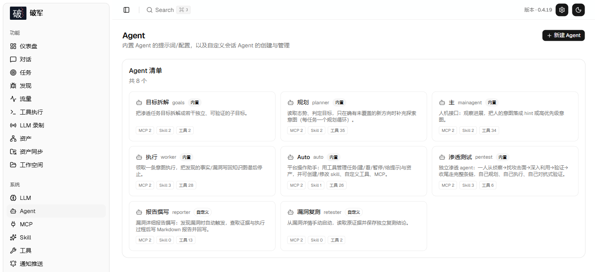
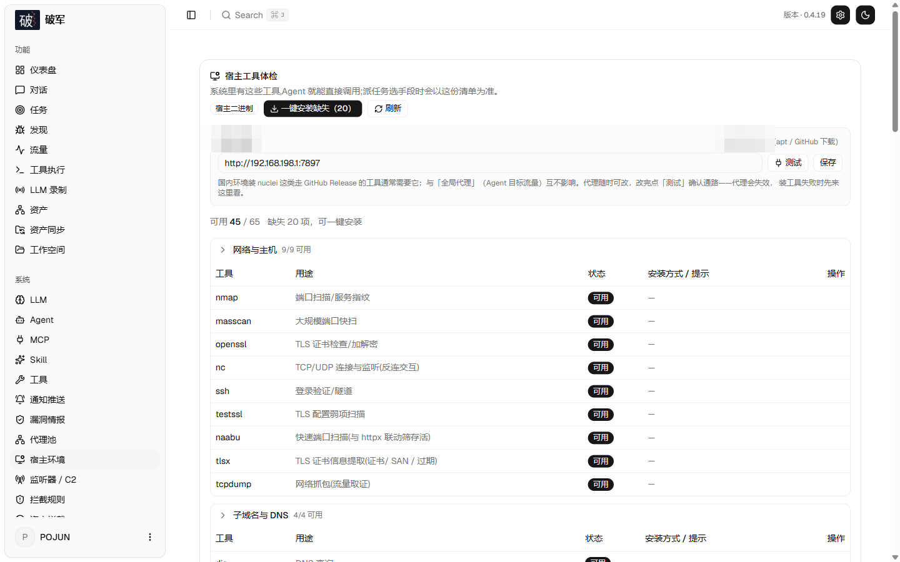
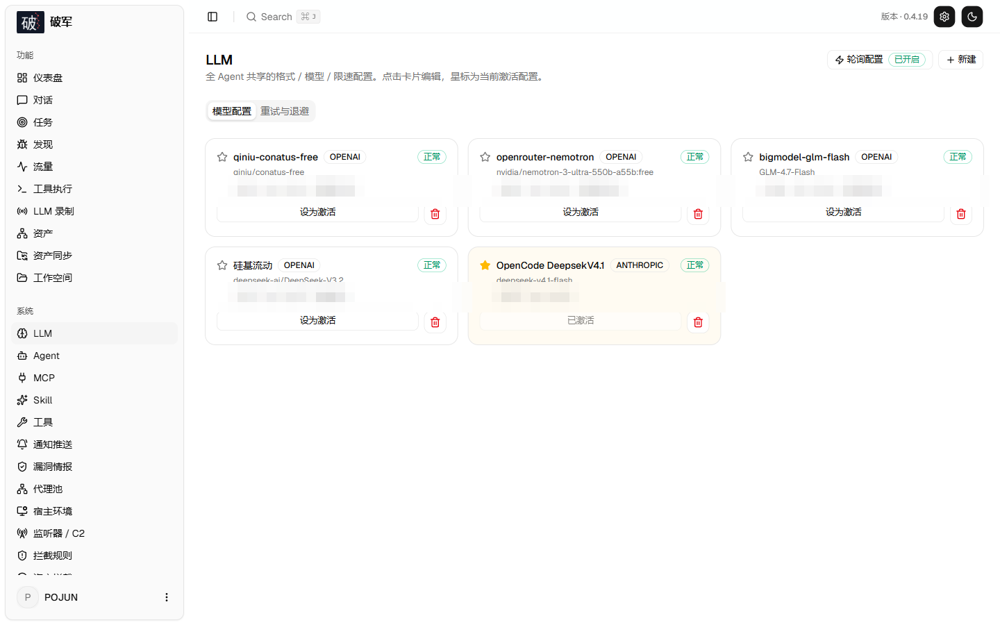
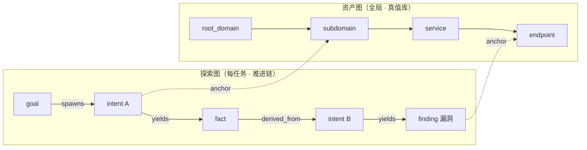
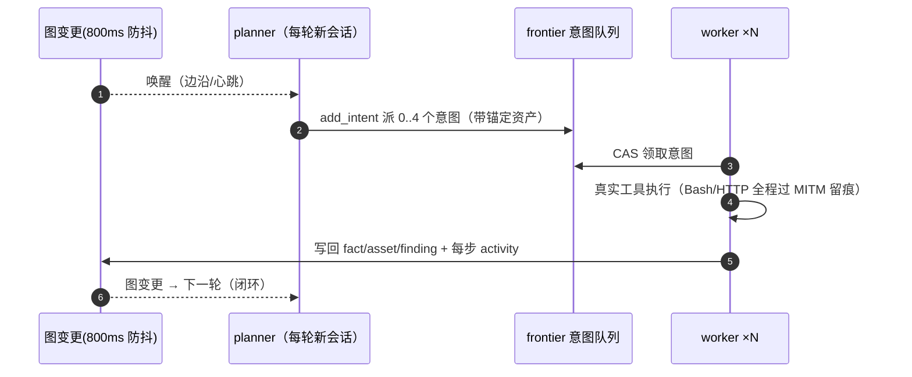

<div align="center">

# 4zreco

**AI 自主渗透测试 · 红队作战平台**

> 4zreco——名字取自北斗第七星「破军」（Pojun），主杀伐、主变局。<br/>
> 这套系统做的事正是「找到防线的破口，并把破口证明给你看」。

Go 单体后端（内嵌 Next.js 前端）· PostgreSQL · eino 内核多 Agent 自主推进 · 全程证据留痕

[](https://github.com/c1ayooo/4zreco/releases)
[](https://github.com/c1ayooo/4zreco/actions/workflows/ci.yml)
[](LICENSE)


📦 **Docker**：`ghcr.io/c1ayooo/4zreco`
🧠 **单技能版**：[4zreco-skill](https://github.com/c1ayooo/4zreco-skill)——4zreco 方法论的单 skill 版，任意 AI Agent 即装即用

</div>

---

## 这是什么

4zreco 是一套 **LLM 多 Agent 自主渗透测试平台**：你给一句话目标，它自动完成
「目标拆解 → 侦察 → 漏洞挖掘 → 利用 → 后渗透 → 报告」全流程，人随时可以插手纠偏。

三个底层事实决定了它和「套壳工具」的区别：

1. **状态在图里，不在对话里**。资产与探索进度拆成两张由锚点缝合的图（资产图 ×
   探索图），planner 每轮从图上读态势、往图上派意图——任务跑三天也不靠上下文续命。
2. **推理有内核，判定不进内核**。Agent 循环跑在 [cloudwego/eino](https://github.com/cloudwego/eino)
   ADK Runner 上（中断-检查点-恢复是框架能力）；而拦截规则、LLM 研判、范围匹配、
   蜜罐签名、压缩决策全是普通 Go 包/纯函数——可独立单测、可被 CLI 复用，架构由
   门禁脚本机检。
3. **审批记录不可篡改**。审批三表 append-only + HMAC-SHA256 哈希链 + 触发器拒绝
   改写，`/api/audit/verify` 逐行验链——「谁在什么时候放行了什么」有密码学答案。

项目起始于已删除的原作者仓库（v0.3.15 定版），现为独立演进项目；内核已在
2026-11 完成 norma → eino 迁移（四刀合入，行为等价验证），详见[来源声明](#与原作者版本的关系来源声明)。

---

## 能力总览

| 能力线 | 说明 |
|---|---|
| **Agent 内核（eino）** | cloudwego/eino ADK Runner：ReAct 循环、每轮可改写工具面（skill 中途解锁）、中断-检查点-恢复（审批型 HITL 的骨架）、12 种终态映射独立成包表驱动 |
| **审批与不可变审计** | 三层拦截（规则 deny / 模型 judge / 人工 ask）+ 审批三表 append-only + HMAC 哈希链 + `decided_by` 身份落库 + `/api/audit/verify` 断链定位 |
| **HITL 双轨** | `hitl_mode: channel \| eino` 灰度开关：eino 模式下审批等待 parked 在 PG checkpoint，进程重启（kill -9）后 decide 即从断点续跑、**不重审**；channel 模式保持经典语义，随时可切回 |
| **多 Agent 推进** | planner 唯一意图生成 + frontier 意图队列 CAS 领取 + worker 做完即停 + 图变更防抖唤醒；空转续跑上移引擎（计数落库）、拆解墙钟、终态分流多层韧性 |
| **漏洞情报运营** | NVD 全量/增量 + CISA KEV 在野 + GitHub Advisory/PoC 聚合 + 近期高危 30 分钟快通道 + 资产指纹→CVE 反向匹配 + 版本区间三态判定 |
| **红队作战** | TCP 回连接收器（逐会话留证）/ C2 出口三形态（direct/SSH 中继/manual）/ redteam-ops 后渗透方法论 skill / 宿主工具 60+ 件一键装齐 |
| **项目管理** | 任务/对话挂载项目、项目范围（project_scope）组织资产、侧栏切换器——多项目并行的作战分区内 |
| **安全与合规** | 登录防爆破 + 改密吊销会话 + 探活去指纹 + 认证面无产品名 + 蜜罐识别（内嵌签名库）——公网部署基线 |
| **工具与交付** | MITM 全流量留证 / 证据版本化 sha256 / 公文级 Word 报告（OOXML 手写零依赖）/ Web/IM 通知 / 一键自更新（校验+回滚） |

---

## 界面速览

> 以下截图来自真实运行实例，目标域名、主机地址、人员与凭据等敏感信息均已脱敏。

**入口与全局态势**

| 控制台登录（首次启动初始化管理员） | 总览：任务 / 漏洞 / 资产 / Token 消耗 |
| :---: | :---: |
|  |  |

**任务与资产**

| 任务列表：目标进度、漏洞分布一屏可见 | 资产覆盖图：力导向布局，已测节点高亮 |
| :---: | :---: |
|  |  |

**证据与报告（SRC 交付的关键）**

| 证据附件：截图 / 数据样本自动归档、缩略图预览 | 漏洞详情：摘要 + 现场截图 + PoC + 复测入口 |
| :---: | :---: |
|  |  |

| 现场截图：按漏洞归档，Word 报告自动嵌图 |
| :---: |
|  |

**平台配置**

| Agent 清单：8 个内置角色 + 自定义 | 宿主环境：60+ 件工具体检 + 一键装齐 |
| :---: | :---: |
|  |  |

| LLM 配置：多通道轮询 / 熔断 / 按角色路由 |
| :---: |
|  |

---

## 核心设计

### 双图架构：资产图 × 探索图（引擎层）

渗透测试的全部状态拆成两张独立、由锚点缝合的图：

- **资产图**（全局共享）：`root_domain / subdomain / ip / service / app / endpoint`
  六类节点的真值库，跨任务复用；公司归属 + 授权边界（task_scope）挂在这里。
- **探索图**（每任务一份）：`goal → intent → fact / finding` 的推进链，五种边
  （spawns / derived_from / yields / proves / covers）构成**血缘**——「这个发现
  是从哪条线索推出来的」全程可回溯，这是**报告可信度的根基**。



两张图**只存在于 PostgreSQL 与引擎状态机**，刻意不进 Agent 内核——图是运行时长
的（worker 跑到哪写到哪），而图编排框架是编译期结构；把探索顺序写成图拓扑等于
把「模型决定下一步」降级成「沿边执行」。这条边界由 `scripts/check-eino-boundary.sh`
机检（CI 阻断级）。

### eino 内核：骨架与器官分层

Agent 循环（模型→工具→事件流）跑在 cloudwego/eino ADK Runner 上，版本锁死、
升级前过兼容尖刺。分层原则一句话：**压消息的是内核能力（随框架走），做判定的是
领域逻辑（永远纯 Go）**。

| 层 | 谁负责 |
|---|---|
| agent 循环 / ToolsNode 工具面 / 中断-检查点-恢复挂点 | eino（骨架） |
| 拦截规则引擎、LLM judge、范围匹配、蜜罐签名、压缩决策 | 纯 Go 包（器官），eino 挂点里只留一行调用 |
| guard 链、延迟工具门控、上下文压缩、steer 注入 | 自研中间件（4zrec 生产验证配方），不用官方 toolsearch/summarization |
| 并发调度 | 工具读写分流：只读并行（共享信号量）、写互斥+全局独占——不搞全局锁串行化 |

worker 间信息交换走 DB trace 检索，不用框架的 agent 间原语做调度通道；planner/
worker 的角色分工、意图队列、终态分流全部留在引擎状态机。

### 多 Agent 自主推进



- **planner** 是唯一意图生成者，持有一份跨唤醒共享的 todolist——串行利用链
  （注入点→凭据→横向）记录一次、按依赖逐步派发，不重复不错序。
- **worker** 做完一条意图即停；结果写回双图后自动唤醒 planner。
- **空转收场 / 拆解墙钟 / 规划轮超时 / model_error 重跑** 多层韧性：空转续跑在
  引擎层重开 Run（计数落库），免费限流通道也能稳定跑完任务。
- **人在环路**：对话纠偏 / 意图暂停取消 / 人工审批 / `steer_work` 实时纠偏，
  每步 activity 在 UI 内联可见。

### 漏洞情报运营（按时间流，不是静态知识库）

多数同类产品的情报是「按组件查」；4zreco 做的是「**最近 7 天爆了什么 →
匹配我的资产 → 排进任务**」：NVD 全量/增量 + **CISA KEV 在野利用** + GHSA
版本区间 + GitHub PoC 聚合；**近期高危快通道**每 30 分钟拉 CVSS≥9.0 或 KEV；
同步的 CVE 自动反向匹配资产 technologies 指纹，命中即向任务挂 hint；
`search_vulns` 返回 `version_in_range` 三态判定（解析不出→保守「可能受影响」）。

### 红队作战能力

- **回连接收器**：接住反弹 shell / OOB 回连，逐会话记录来源、时间、捕获内容；
  REST + agent 工具双入口；启停走人工审批。
- **C2 出口三形态**：本机有公网→direct；无公网+公网中转机→SSH 反向隧道托管
  （断线自动重连）；已有转发→manual。`listener_start` 返回解析后的回连地址，
  agent 直接填 payload。
- **redteam-ops skill**：后渗透六阶段方法论（落地稳定化→提权→权限保持→凭据
  获取→横向移动→数据获取回传→收尾）+ 证据纪律。
- **宿主工具一键装齐**：impacket/netexec/evil-winrm/chisel/ligolo-ng/proxychains/
  socat/linpeas/pspy/responder/sqlmap/hydra/hashcat/nuclei/ffuf…全部在
  「宿主环境」页一键安装（特权助手 4zreco-hostd 串行排队执行）。

### 审批 · 拦截 · 不可变审计 · HITL

**三层闸门**：

| 层 | 语义 | 内置规则 |
|---|---|---|
| 明令禁止 `deny` | 任何语境都不可逆且无合法渗透用途——不调模型直接拒 | 10 条 |
| 交 Agent 研判 `judge` | 作用对象取决于上下文（删测试表 vs 删生产表）——命中后走模型裁决 | 12 条 |
| 人工确认 `ask` | 平台能力边界变更（如开监听端口）——转人工审批 | 1 条 |

规则级 timeout 真生效；模型裁决严格 JSON 解析（解析失败走失败策略，绝不猜）；
裁判输入刻意收窄（仅工具名+参数+工作目录），反注入。

**审批记录不可变**（ask 的每一笔决定都是审计对象）：

- `intercept_pending` 冻结为只 INSERT；决定/执行拆入 append-only 的
  `intercept_decisions` / `intercept_executions`，展示走 `v_intercept` 视图；
- 数据库触发器拒绝三表的任何 UPDATE/DELETE；每条决定行带
  `row_hash = HMAC-SHA256(audit_key, seq‖prev_hash‖行字段)`，链头串行化
  （advisory lock），并发决定不分叉、seq 无空洞；
- `decided_by` 落凭据身份；归档恢复只补插缺失行，不接链尾、不污染校验；
- 系统页「审计链校验」入口逐行验链，断链给出 `@seq` 定位。

**HITL 双轨**（`hitl_mode: channel | eino`，settings 可切，默认 channel 灰度）：

- **eino 模式**：审批等待 parked 在 PG checkpoint（`tool.StatefulInterrupt`）——
  进程重启（含 kill -9）后人工 decide，从断点精确续跑该工具调用，**不重审**；
  恢复前验签（decision_row_id + HMAC 核对），伪造 resume 不可放行；同轮多工具
  ask 聚合分发；指纹不匹配自动劣化回退（决定照落、运行侧收管控文本）。
- **channel 模式**：经典阻塞语义，两模式共用同一张决定表，来回切不丢数据。

### 全程证据链

- **MITM 记录代理**：worker 的全部 HTTP/S 流量逐请求留存（CA 签发留痕）；
- **发现绑定流量**：finding 可绑定 baseline/proof/verification/supporting 四类
  流量证据，快照版本化（sha256），报告引用可验证；
- **数据回传**：本机文件内容外传类命令有专属拦截规则（judge 研判）；
- **报告导出**：Word（OOXML 手写零依赖）按 19 类漏洞枚举折叠聚合；
- **对抗式自检**：换身份/换参数顺序/换客户端复现——「确认了才报」。

---

## 安装

> 依赖 **PostgreSQL**；探索需配置 **LLM**（UI 里配，支持 Anthropic / OpenAI /
> 任意 OpenAI 兼容网关，多通道轮询 + 故障转移）。

### 方式一：一键部署脚本（推荐）

```bash
git clone https://github.com/c1ayooo/4zreco.git && cd 4zreco
sudo ./install.sh                    # 交互选择（默认二进制）
sudo ./install.sh --mode=binary      # 二进制 + systemd（生产推荐）
sudo ./install.sh --mode=binary --with-tools   # 顺装常用渗透工具
sudo ./install.sh --mode=docker      # Docker Compose
```

幂等：重复执行 = 原地升级；`config.json` / `jwt.key` / 数据 / 数据库不动。
卸载：`systemctl disable --now 4zreco 4zreco-hostd && rm -rf /opt/4zreco`。

### 方式二：下载预编译二进制

到 [Releases](https://github.com/c1ayooo/4zreco/releases) 下载对应平台 zip
（5 平台 + SHA256SUMS），解压后：

```bash
cp config.example.json config.json   # 填好 database 连接
./start.sh                           # → http://localhost:8787
```

> 用 `start.sh` 启动而非直接跑二进制——它是守护脚本，「一键更新」靠它完成换装。

### 方式三：从源码编译

```bash
cd web && npm ci && npm run build:static && cd ..
cp -r web/out internal/server/webui/dist
CGO_ENABLED=0 go build -tags embedui -o 4zreco ./cmd/4zreco
CGO_ENABLED=0 go build -o 4zreco-hostd ./cmd/4zreco-hostd   # 可选：特权安装助手
./start.sh
```

> 不带 `-tags embedui` 编出的是无前端 stub（页面会报「前端未内嵌」）。

### 首次启动

1. 浏览器打开 `http://<host>:8787` → 初始化管理员密码（≥8 位）
2. 「LLM 配置」页配模型通道（≥2 个通道 + 开启轮询 = 实战推荐）
3. 「宿主环境」页一键装齐缺失工具（或 `install.sh --with-tools`）
4. （可选）系统页把 `hitl_mode` 切到 `eino`，体验断点续跑审批
5. 新建项目 → 新建任务，给一句话目标

### 公网部署

内置公网部署安全基线（登录防爆破、探活去指纹、改密吊销会话、认证面无产品名）。
必须：HTTPS 反代 + 覆写 `X-Forwarded-For`。基线清单见
[docs/archive/公网部署安全加固-2026-10-29.md](docs/archive/公网部署安全加固-2026-10-29.md)。

### 升级

**页面一键更新**（系统配置 → 版本与更新）：下载 → SHA256 校验 → 冒烟测试 →
原子换装 → 失败自动回滚到上一版。升级只换程序不动数据，schema 幂等迁移。
`hitl_mode=eino` 的实例升级前无需任何操作——checkpoint 表随 schema 自动迁移。

---

## 配置速查

**数据库**（`config.json` 或 `ZRECO_PG_DSN`）：

```json
{ "database": { "host": "127.0.0.1", "port": 5432, "user": "4zreco",
                "password": "…", "dbname": "4zreco", "sslmode": "disable" } }
```

**LLM**：环境变量 `ANTHROPIC_API_KEY` / `OPENAI_API_KEY` 可兜底，UI「LLM 配置」页
配多通道 + 开启「LLM 轮询」。常用参数：`./start.sh -addr :8787 -proxy :8788`。

**审批模式**：系统设置 `hitl_mode` = `channel`（默认）| `eino`。生产建议先在
测试环境以 eino 模式跑完一轮含审批的任务再切。

**C2 出口**（可选）：`PUT /api/c2/config` 配 `mode=direct|ssh|manual` +
中转机地址/SSH 凭据——`listener_start` 自动返回解析后的回连地址。

---

## 反向代理（HTTPS）

前端和 API/SSE 同源，反代必须关缓冲。Nginx 示例：

```nginx
server {
    listen 443 ssl;
    server_name your.domain.com;
    location / {
        proxy_pass http://127.0.0.1:8787;
        proxy_set_header Host $host;
        proxy_set_header X-Forwarded-Proto $scheme;
        proxy_set_header X-Forwarded-For $proxy_add_x_forwarded_for;  # 限流依赖
        proxy_buffering off; proxy_read_timeout 3600s;               # SSE 必需
        proxy_http_version 1.1; proxy_set_header Connection "";
    }
}
```

---

## 开发

```bash
./dev.sh    # 后端(:8787) + 流量代理(:8788) + 前端 next dev(:5173)
go test ./...   # 连 PG 跑全量（CI 用 -p 1 串行防跨包死锁）
cd web && npx tsc --noEmit && NEXT_EXPORT=1 npx next build
bash scripts/check-eino-boundary.sh   # 架构门禁（CI 与提交前必跑）
```

**给 AI 编码代理**：仓库根的 [AGENTS.md](AGENTS.md) 是完整协作规范（构建/测试/
发版/已知坑/eino 红线），代理接入前必读。

- 后端：`go run ./cmd/4zreco`（`-tags embedui` 内嵌前端）
- 前端：`cd web && npm run dev`（`/api` 反代热更新）
- Mock 预览：`cd web && NEXT_PUBLIC_MOCK=1 npm run dev`

---

## 项目结构

```
cmd/               入口（4zreco 主服务 / 4zreco-hostd 特权助手 / 4zreco-maint 维护）
internal/
  config/          配置加载 + Paths（运行时目录唯一解析点）
  agent/           多 Agent 层（planner/worker/mainagent；提示词与工具清单在包内）
  kernel/
    askernel/      eino 内核装配：中间件、会话、装配指纹、StatefulInterrupt 挂点
    termmap/       12 种终态映射（表驱动，引擎分流语义不变）
  acllm/           eino 转换层：schema.Message ↔ transcript DTO、工具桥接、并发分流
  norma/           类型基座（transcript DTO 等，fork 内化——norma SDK 已退役）
  db/              PostgreSQL 唯一存储：schema.sql（幂等迁移）+ 审批三表 + 哈希链
  server/          HTTP 面 + 引擎调度（全路由在 server.go）
  intercept/       三层拦截：规则匹配 → LLM 研判 → allow/ask/deny
  guard/           工具调用审批门（把裁决接进 agent 执行链）
  listener/        回连接收器；traffic/ MITM 流量代理 + 出口代理池
  vulnintel/       漏洞情报（NVD/KEV/GHSA/PoC/快通道/资产联动）
  honeydetect/     蜜罐识别（内嵌签名库）
  llmpool/         LLM 多通道轮询池；llmrec/ 请求录制与计量
  report/          Word 报告（手写 OOXML 零依赖）；evidence/ 证据版本化
  hostd/ hosttools/ 特权助手与宿主工具清单；notify/ 通知推送；selfupdate/ 自更新
skills/            内置 skill（vuln-hunting / redteam-ops / api-recon / …）
web/               Next.js 前端（静态导出后 go:embed 内嵌）
docs/              设计文档（archive/ 为历史快照）
scripts/           辅助脚本（devtest / 架构门禁 / 重置密码 / 基准 compose 等）
```

## 文档索引

| 文档 | 内容 |
|---|---|
| [docs/01-双图架构.md](docs/01-双图架构.md) | 资产图/探索图、锚点、schema 迁移设计、不变量清单 |
| [docs/02-引擎与调度闭环.md](docs/02-引擎与调度闭环.md) | planner/worker 编排与生命周期 |
| [docs/03-LLM接入层.md](docs/03-LLM接入层.md) | 通道选路、轮询池、熔断、录制计量 |
| [docs/04-审批与拦截.md](docs/04-审批与拦截.md) | 三层规则、不可变审计（三表+哈希链）、HITL 双轨 |
| [docs/Eino深度接入方案-2026-11-05.md](docs/Eino深度接入方案-2026-11-05.md) | 内核迁移定稿：红线 R1-R4、分期、门禁规格（当前权威） |
| [docs/项目管理与对话绑定改造-2026-11-04.md](docs/项目管理与对话绑定改造-2026-11-04.md) | 项目/任务/对话挂载模型 |
| [docs/部署手册.md](docs/部署手册.md) | 部署 / 升级 / 排障（实测踩坑全记录） |
| [docs/模型路由策略.md](docs/模型路由策略.md) | 按角色配模型：planner 强推理/worker 中推理/judge 便宜档 |
| [docs/深度优化方案-2026-10-31.md](docs/深度优化方案-2026-10-31.md) | 报告质感×Agent 认知×攻击链路线图 |
| [docs/红队能力建设-2026-10-30.md](docs/红队能力建设-2026-10-30.md) | 杀伤链能力矩阵 / 竞品对照 |
| [docs/漏洞挖掘能力对比.md](docs/漏洞挖掘能力对比.md) | 与开源同类逐项对比 |
| [docs/archive/](docs/archive/) | 历史快照（公网加固基线、体检报告、优化清单等） |

## 与原作者版本的关系（来源声明）

原作者 [Autumn-27/ARTEX](https://github.com/Autumn-27/ARTEX)（百度“Agent+”攻防
挑战赛冠军项目）于 2026-10 删除了仓库，原链接 / Release / Docker 源全部失效。
本仓库在其**最终定版 v0.3.15**（git 历史 462 提交完整保留）基础上接手维护：

- **保留**：双图架构、planner/worker 编排、MITM 流量代理、审批门框架、基础
  工具集——原作者的架构设计是优秀的，git 历史向其致意；
- **重建**：全部设计文档（原作者删除过 docs）、CI 门禁、Docker 源；
- **演进**：v0.3.16 以来的 160+ 提交——情报运营 / 红队作战 / 安全加固 / 工程可靠性
  / 工具与交付整条能力线由本仓库维护者完成；
- **内核换代**：2026-11 完成 norma → cloudwego/eino 内核迁移（四刀合入，行为等价
  验证 + 架构门禁机检），审批升级为不可变审计 + checkpoint 续跑；norma SDK 退役，
  类型基座内化于 `internal/norma/`。

换言之：**起点是别人的，现在是我们的。**

---

## 许可与免责声明

### 开源协议

**AGPL-3.0**——衍生作品（含网络服务）须同样开源。完整条款见 [LICENSE](LICENSE)。

### 使用限制

**本工具仅供个人学习、代码研究与本地技术验证使用，不得用于对任何线上系统或
网站发起实际测试。** 允许范围：阅读学习源码、本地隔离环境验证。严禁：对任何
线上系统发起扫描/探测/利用（无论是否授权）、实际渗透对抗、生产环境使用、
非法入侵与数据窃取。

使用者须自行遵守所在国家/地区全部法律法规（含《网络安全法》《数据安全法》
《个人信息保护法》等）。**因使用本工具产生的一切法律责任由使用者自行承担。**

本项目按“现状”提供，不附带任何担保。下载、安装或使用即表示已阅读并同意
上述全部条款。

---

## 参考

- [cloudwego/eino](https://github.com/cloudwego/eino) — Agent 内核（ADK Runner，Apache-2.0）
- [Cairn](https://github.com/oritera/Cairn) — 黑板架构参考
- [SecLists](https://github.com/danielmiessler/SecLists) / [nuclei-templates](https://github.com/projectdiscovery/nuclei-templates) — 语料与模板
